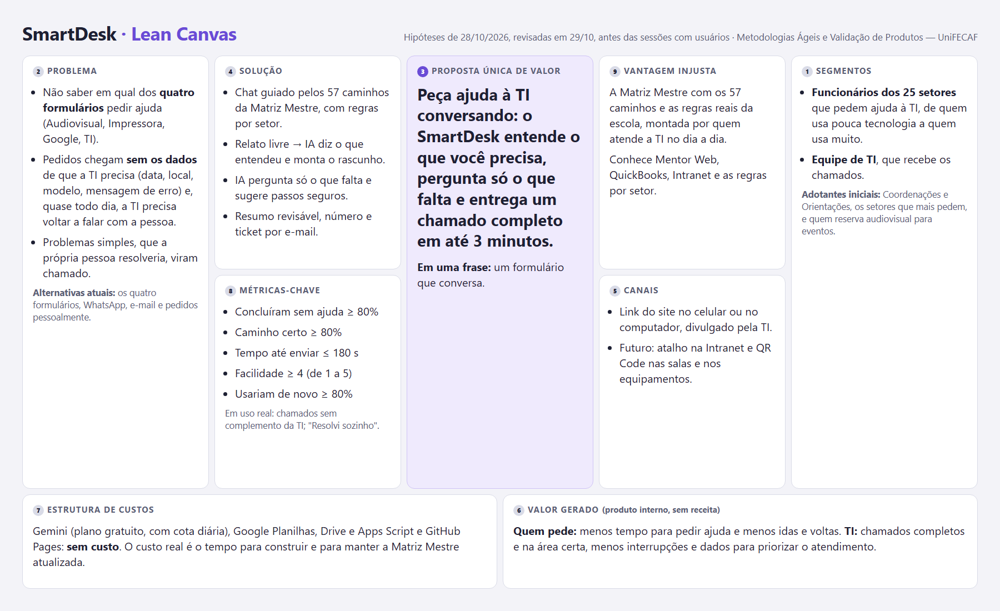

# Lean Canvas do SmartDesk

- [`lean-canvas.md`](lean-canvas.md): os nove blocos em texto, com as observações.
- [`lean-canvas.html`](lean-canvas.html): a fonte da imagem. Para gerar o PNG de novo, abra o arquivo numa janela de 1800 × 1100 e capture a tela.

Cada bloco é uma hipótese de 28/10/2026 (revisada em 29/10), anterior às sessões com usuários. Depois das sessões, cada bloco ganha a marca de confirmado, derrubado ou não testado. Como o SmartDesk é um produto interno, o bloco "Fontes de receita" virou "Valor gerado".
