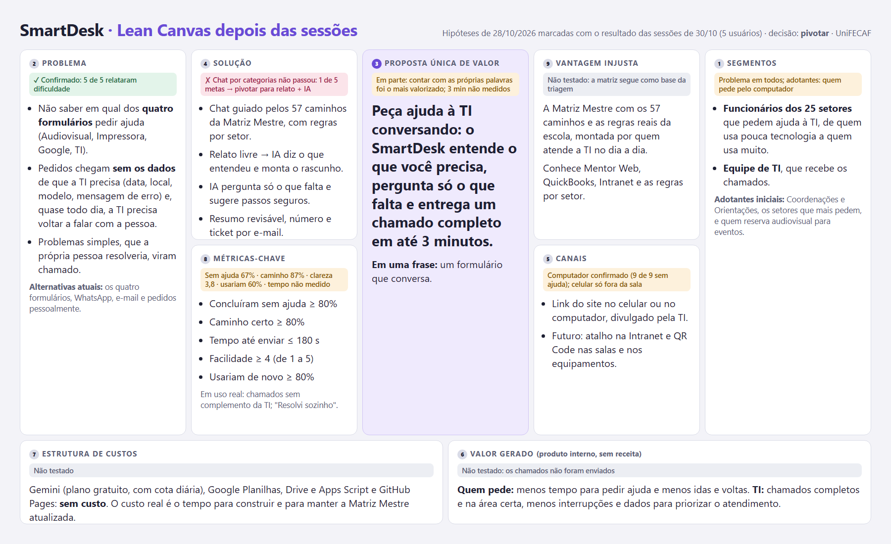

# Lean Canvas do SmartDesk

**Antes das sessões** (hipóteses de 28/10/2026, revisadas em 29/10):

**Depois das sessões** (resultado de 30/10/2026; decisão: pivotar):

- [`lean-canvas.md`](lean-canvas.md): os nove blocos em texto, com as observações.
- [`lean-canvas-pos-sessoes.png`](lean-canvas-pos-sessoes.png) (fonte [`lean-canvas-pos-sessoes.html`](lean-canvas-pos-sessoes.html)): o mesmo Canvas marcado com o resultado das sessões de 30/10/2026 (confirmado, em parte, derrubado ou não testado). Decisão: pivotar.
- [`lean-canvas.html`](lean-canvas.html): a fonte da imagem. Para gerar o PNG de novo, abra o arquivo numa janela de 1800 × 1100 e capture a tela.

Cada bloco é uma hipótese de 28/10/2026 (revisada em 29/10), anterior às sessões com usuários. Depois das sessões, cada bloco ganhou a marca de confirmado, em parte, derrubado ou não testado. Como o SmartDesk é um produto interno, o bloco "Fontes de receita" virou "Valor gerado".
