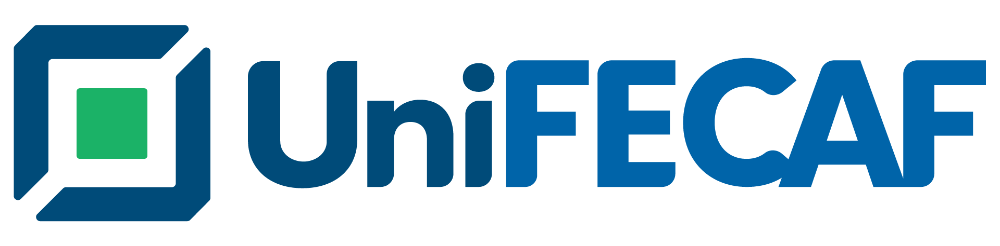

# SmartDesk — assistente de suporte de TI com IA

## Da hipótese à evidência: validando um assistente para pedir ajuda à TI de uma escola

**Curso:** Graduação IA e Automação Digital
**Disciplina:** Metodologias Ágeis e Validação de Produtos
**Aluno:** Anderson Barbosa Marques da Silva
**RA:** 16732
**Data:** 31 de outubro de 2026

## Links de acesso

- **Protótipo (chat):** <https://andymarksss.github.io/Assistente-SmartDesk/>
- **Painel de gestão da TI:** <https://andymarksss.github.io/Assistente-SmartDesk/admin.html>
- **Vídeo pitch (até 4 minutos):** *link a incluir depois da gravação*
- **Parte teórica (hipóteses e estratégia de validação):** [`parte-teorica-hipoteses-e-validacao.md`](../parte-teorica-hipoteses-e-validacao.md)

> Resumo: o problema se confirmou (5 de 5 funcionários relataram dificuldade para pedir ajuda à TI), mas a solução testada, um chat que guia por 57 categorias, só atingiu 1 das 5 metas definidas antes do teste. Pela regra de decisão aprovada antes das sessões, a decisão é **pivotar**: manter o problema e trocar a forma da solução por uma entrada única em que a pessoa conta o que precisa e a IA monta o pedido.

## 1. Problema e oportunidade

Na escola onde trabalho no suporte de TI, os pedidos chegam por quatro formulários separados (Audiovisual, Impressora, Google e TI) e também por WhatsApp, e-mail e pessoalmente. Para usar o formulário, a pessoa precisa saber qual escolher e quais dados informar. Quase todo dia a TI precisa voltar a falar com alguém porque faltou um dado no pedido. Isso vem da minha rotina no suporte e não foi medido.

- **Público:** funcionários dos 25 setores da escola, com níveis muito diferentes de familiaridade com tecnologia. Do outro lado, a equipe de TI, que recebe os pedidos.
- **Oportunidade:** o conhecimento de como atender já existe. A *Matriz Mestre de Chamados*, montada a partir dos formulários, tem 57 caminhos de atendimento, 10 regras e as restrições por setor. A IA generativa permite que a pessoa conte o problema com as próprias palavras.

## 2. Hipóteses e critérios definidos antes do teste

| Tipo | Hipótese | Critério |
|---|---|---|
| Problema | Os funcionários têm dificuldade para saber onde e como pedir ajuda à TI. | Confirma-se se pelo menos 3 de 5 relatarem dificuldade no jeito atual. |
| Solução | Funcionários conseguem abrir um chamado completo pelo SmartDesk sozinhos, no caminho certo e em até 3 minutos. | Sem ajuda ≥ 80% · caminho certo ≥ 80% · tempo médio ≤ 180 s |
| Valor | Quem usa o SmartDesk prefere esse jeito e usaria de novo. | Facilidade ≥ 4 (de 1 a 5) · usariam de novo ≥ 80% |

**Linha do tempo dos critérios, todos anteriores às sessões:**
- metas escritas na planilha em 19/10 ([EVID-216](../../05-evidencias/EVID-216_hipotese-e-metas-antes-dos-testes.png));
- regra de decisão aprovada em 28/10;
- critério da hipótese de problema e casos que faltavam na regra aprovados em 29/10;
- sessões em 30/10.

**Regra de decisão:**

| Resultado | Decisão |
|---|---|
| Problema confirmado e pelo menos 4 das 5 metas, incluindo "sem ajuda" e "caminho certo" | Perseverar |
| Problema confirmado, mas só 2 ou 3 metas | Ajustar |
| Problema confirmado, mas "usariam" < 50%, a maioria prefere o jeito atual ou no máximo 1 meta | **Pivotar** |
| No máximo 1 de 5 relata dificuldade | Abandonar |
| Exatamente 2 de 5 relatam dificuldade | Inconclusivo: mais 3 pessoas |

## 3. Solução testada e MVP

O SmartDesk é um chat de atendimento da TI (versão 0.13). A pessoa pode pedir de dois jeitos:
- **Pelos botões:** escolhe a área e o tipo de ajuda pelos 57 caminhos da Matriz Mestre, e o chat pergunta só os dados daquele caminho.
- **Com as próprias palavras:** conta o problema, e a IA (Gemini) diz o que entendeu, monta um rascunho e pergunta o que faltar.

Em defeitos simples, aparecem passos seguros para tentar antes de abrir o chamado. A pessoa confere tudo num resumo, envia e recebe um número e o ticket por e-mail. A equipe de TI acompanha os chamados num painel com etapas.

- **Limites da IA:** a IA não conversa livremente, não muda a escolha da pessoa e não recebe nome, e-mail nem anexos. Toda sugestão passa por confirmação.
- **Fluxo completo:** [árvore de decisões e passo a passo](../fluxo/README.md).
- **Lean Canvas:** [antes e depois das sessões](../canvas/README.md).

**O MVP ficou maior que o necessário:** construí um fluxo completo antes de ouvir usuários. Isso custou tempo e, como os resultados mostraram, parte desse esforço foi para uma forma de solução que não passou no teste. Esse é o primeiro aprendizado do case (seção 8).

## 4. Experimento

**Planejado:** teste de usabilidade moderado, uma pessoa por vez, com 3 situações reais de pedido à TI e uma conversa curta no fim. As métricas seriam gravadas automaticamente pelo SmartDesk e uma ficha de observação seria preenchida durante cada sessão ([roteiro](../../04-validacao/roteiros/roteiro-sessao-usuarios.md)).

**Realizado em 30/10/2026:**
- **Participantes:** 5 funcionários que pedem ajuda à TI, de quatro setores (Orientação, Secretaria, Financeiro e duas Coordenações).
- **Perfil:** uso de tecnologia baixo para 2, médio para 2 e alto para 1. Três fizeram o teste no computador e dois no celular, cada um no próprio aparelho.
- **Tarefas:** 3 situações cada um, num rodízio de 11 cenários da Matriz Mestre. São 15 tarefas no total.
- **Fichas:** cada participante digitou a própria ficha durante o uso: como pediu, se chegou ao tipo certo, se precisou de ajuda, clareza, falas e conversa final ([EVID-307](../../05-evidencias/EVID-307_fichas-sessoes-p01-p05-transcricao.md)).

**Diferenças em relação ao planejado** (limitações):

| Planejado | Realizado | Efeito |
|---|---|---|
| Uma pessoa por vez, sem explicar o sistema antes | As cinco juntas numa sala, depois de uma apresentação do projeto e de como usar | A apresentação pode ter ajudado, então os resultados podem estar otimistas. Em grupo, uma pessoa pode ter influenciado a outra |
| Facilitador observando cada um | Cada um declarou na ficha o próprio resultado | "Sem ajuda" e "caminho certo" são autodeclarados |
| Enviar o chamado no fim | Todos pararam no resumo | Sem o tempo até enviar e sem a nota de facilidade do chat, que só aparece depois do envio |
| Métricas automáticas na aba *Sessões* | Não há registro dessas sessões na aba (nenhum atendimento no período). A causa não foi identificada | Todos os números vêm das fichas |
| Fichas com a data da sessão | Fichas datadas de 28/10 por engano | As sessões foram em 30/10 |

Com 5 pessoas, cada uma equivale a 20%. Os números servem para enxergar padrões, não têm valor estatístico.

## 5. Evidências e resultados

Números completos em [`resultados-sessoes-2026-10-30.md`](../../04-validacao/resultados/resultados-sessoes-2026-10-30.md); síntese em [`diario-validacao.md`](../../04-validacao/registros/diario-validacao.md).

**Hipótese de problema: confirmada.** 5 de 5 relataram dificuldade no jeito atual:

| Dificuldade marcada | Quantos |
|---|---|
| Não saber o formulário certo | 2 |
| Completar as informações | 2 |
| Esperar o retorno | 1 |

- Uma pessoa já deixou de abrir pedido por não saber a categoria.
- Outra tem "medo de colocar no assunto errado".

**Metas:**

| Meta | Resultado | Atingida? |
|---|---|---|
| Concluíram sem ajuda ≥ 80% | 10 de 15 tarefas (67%) | Não |
| Chegaram ao caminho certo ≥ 80% | 13 de 15 (87%) | **Sim** |
| Tempo médio até enviar ≤ 180 s | Não medido | Não |
| Facilidade ≥ 4 | Não medida pela nota do chat; a clareza das perguntas, na ficha, deu média 3,8 | Não |
| Usariam de novo ≥ 80% | 3 de 5 (60%) | Não |

**Outros dados:**
- **Comparação com o jeito de hoje:** 2 acharam mais fácil, 2 igual e 1 mais difícil.
- **Recomendação de 0 a 10:** média 7,4 (notas 9, 9, 8, 6 e 5).

**O padrão mais forte: computador × celular**

| | Sem ajuda | Caminho certo | Clareza | Usaria de novo |
|---|---|---|---|---|
| Computador (3 pessoas, 9 tarefas) | 9 de 9 | 8 de 9 | 4,3 | 8 de 9 |
| Celular (2 pessoas, 6 tarefas) | 1 de 6 | 5 de 6 | 3,0 | 1 de 6 |

As duas pessoas do celular também são as de pouco uso de tecnologia, então não dá para separar os dois efeitos.

**O que se repetiu em 2 ou mais pessoas:**
- **Opções exclusivas de um setor não foram encontradas:** QuickBooks e Câmeras. Os dois foram parar em "Outros", e são os dois únicos caminhos errados.
- **Opções parecidas se confundem:** "Projetor" e "Troca de cabo HDMI".
- **Pedidos de evento:** não ficou claro onde informar o local e o horário, nem se a informação "chega para a TI".
- **O que mais agradou:**
  - contar o problema com as próprias palavras: "Eu escrevi o que precisava e o sistema organizou as informações";
  - revisar o resumo antes de enviar.

## 6. Hipótese × resultado

| Hipótese | Resultado | Por quê |
|---|---|---|
| Problema | **Confirmada** | 5 de 5 relataram dificuldade, acima do critério de 3 de 5 |
| Solução | **Não confirmada** | O caminho certo passou (87%), mas sem ajuda ficou em 67% e o tempo não foi medido. Os erros vieram da navegação por categorias, e quase toda a ajuda foi no celular |
| Valor | **Não confirmada** | Só 60% usariam no dia a dia, e a clareza ficou em 3,8. Mesmo assim, ninguém preferiu claramente o jeito atual: 1 de 5 achou mais difícil |

## 7. Decisão: pivotar

Pela regra definida antes das sessões, com o problema confirmado e no máximo 1 meta atingida, a decisão é **pivotar**: manter o problema e mudar a forma da solução.

**Para onde pivotar**, a partir das evidências:
- O valor percebido está em **contar o que precisa e conferir o resumo**, não em navegar por 57 categorias. Os dois caminhos errados e as confusões vieram da navegação.
- No **computador**, onde os funcionários do administrativo e da coordenação fazem os pedidos, a experiência funcionou (9 de 9 sem ajuda).
- **Nova forma:** uma entrada única dentro do portal que a escola já usa. A pessoa escreve o que precisa, a IA identifica o formulário certo, preenche o que já foi dito, pergunta só o que falta e mostra o resumo para confirmar. A pessoa deixa de escolher categorias. Esse pivô estava entre as alternativas escritas antes das sessões na parte teórica.

**Próximo passo recomendado:**
1. Testar esse formato com o menor experimento possível: uma caixa "conte o que precisa" sobre os formulários atuais, reaproveitando a identificação e o rascunho da IA que já existem, primeiro no computador.
2. Usar sessões individuais, com o envio do chamado e o registro automático funcionando, para medir tempo e facilidade.
3. Manter as metas (sem ajuda e caminho certo ≥ 80%, tempo ≤ 180 s) e o mesmo tipo de regra de decisão definida antes.

## 8. Aprendizados

- **Sobre o problema:** ele é real e frequente. Não saber qual formulário usar e o que informar aparece em todos os relatos, e os pedidos também chegam por WhatsApp e pessoalmente.
- **Sobre a solução:** a IA foi mais valorizada como tradutora do pedido do que a organização em categorias. Categorias exclusivas de um setor ficam invisíveis para quem não sabe que existem, e o celular exige uma experiência bem mais curta.
- **Sobre o processo:**
  - Construí demais antes de testar. Um experimento menor, como um formulário único com triagem feita à mão pela TI, teria mostrado o mesmo com menos esforço.
  - Na execução, a sessão em grupo e a falta de envio custaram métricas importantes; o próximo teste precisa ser individual e completo.
  - Definir a regra de decisão antes ajudou: o resultado desfavorável levou a uma decisão clara, sem ajustar critérios depois.
- **Sobre a IA no discovery:** a IA ajudou a planejar, construir, avaliar tecnicamente o protótipo (99% de caminho certo em relatos fictícios) e organizar os dados. Ela não validou nada: com pessoas reais, a solução não passou nas metas. É a regra do enunciado na prática: "IA não valida mercado. Pessoas reais validam hipóteses."

## 9. Como testar e materiais

- **Testar:** abra o [chat](https://andymarksss.github.io/Assistente-SmartDesk/) e use dados fictícios (por exemplo, nome@exemplo.com), porque os chamados chegam à planilha da equipe de TI. Para rodar localmente: [`03-prototipo`](../../03-prototipo/README.md).
- **Parte teórica:** [hipóteses e estratégia de validação](../parte-teorica-hipoteses-e-validacao.md).
- **Validação:** [roteiro](../../04-validacao/roteiros/roteiro-sessao-usuarios.md), [kit das sessões](../../04-validacao/registros/kit-impressao-sessoes.pdf), [fichas transcritas (EVID-307)](../../05-evidencias/EVID-307_fichas-sessoes-p01-p05-transcricao.md), [resultados](../../04-validacao/resultados/resultados-sessoes-2026-10-30.md) e [síntese](../../04-validacao/registros/diario-validacao.md).
- **Avaliação técnica da IA:** [relatos fictícios e verificação dos 57 caminhos](../../04-validacao/avaliacao-ia/README.md).
- **Construção:** [CHANGELOG](../../03-prototipo/CHANGELOG.md), [verificações por versão](../../03-prototipo/verificacoes/README.md), [decisões](../../01-planejamento/decisoes.md) e [evidências numeradas](../../05-evidencias/README.md).
