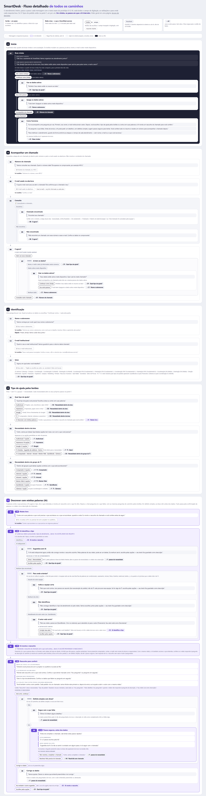
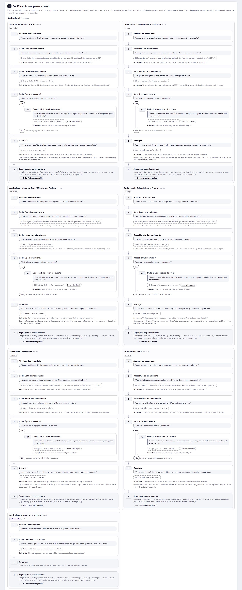
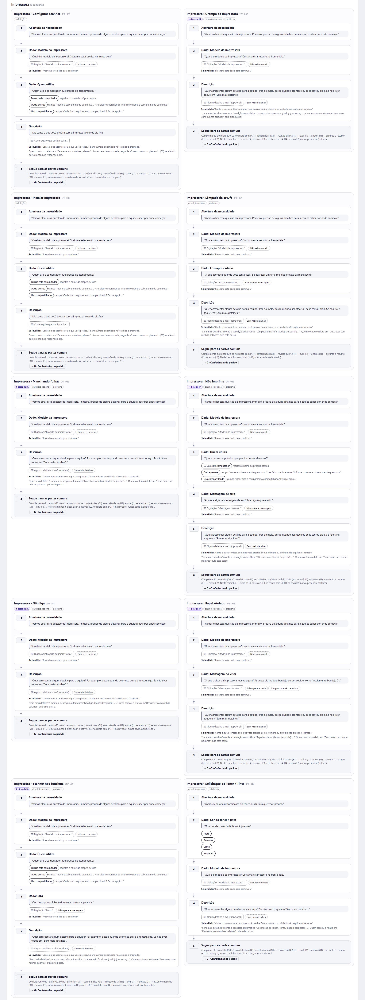
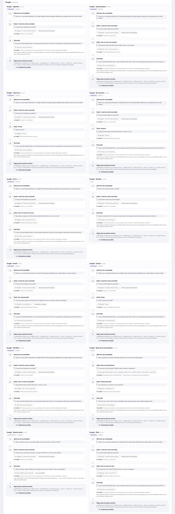
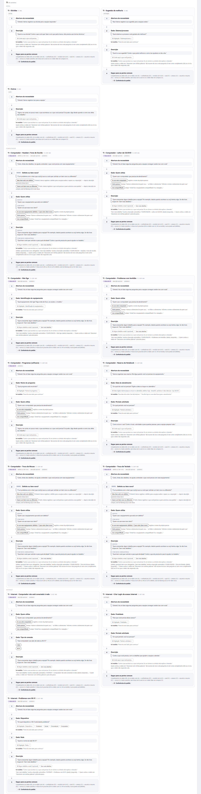
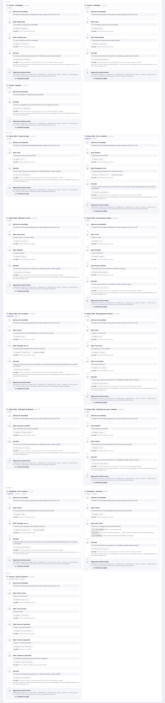
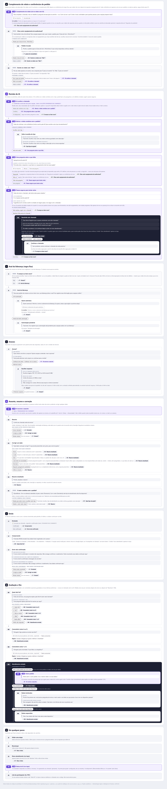
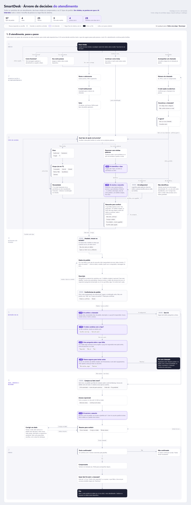
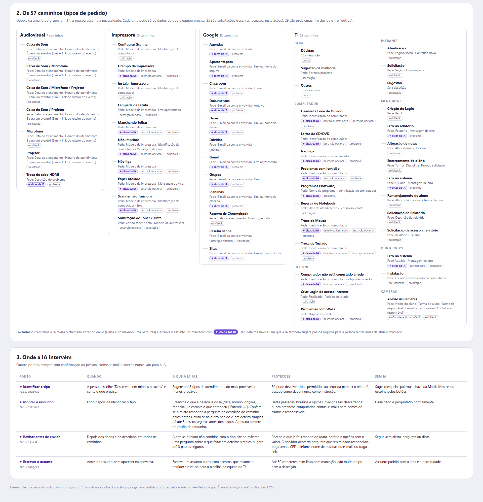

# Fluxo do atendimento do SmartDesk

Todos os caminhos possíveis dentro do SmartDesk, do início ao fim, com base no protótipo 0.13.0 (as árvores são as da 0.12.18: a 0.13.0 só mudou o texto do comprovante, no passo L2 do passo a passo). Vale também para a 0.13.1, a versão final, que só acrescentou o robô no quadro de boas-vindas do celular. **Em violeta, os pontos em que a IA intervém**; borda tracejada é regra fixa do sistema, sem IA.

| Arquivo | O que é |
|---|---|
| [`arvore-completa.html`](arvore-completa.html) | **A árvore de decisões completa**, da raiz (boas-vindas) a cada folha: 613 nós, os 57 tipos de pedido com todos os dados e escolhas, até o fim. Abra no navegador: zoom pelos botões ou Ctrl + roda do mouse, arraste para mover, passe o mouse num passo para ver a pergunta exata do chat. |
| [`arvore-vertical.html`](arvore-vertical.html) | **A mesma árvore na vertical**: a raiz em cima e as escolhas descendo até o fim. Mesmos 613 nós e mesmos controles. |
| [`arvore-estrutura.js`](arvore-estrutura.js) | A estrutura da árvore (nós e ramos), usada pelas duas versões; assim elas nunca ficam diferentes. |
| [`imagens-arvore/`](imagens-arvore) | As duas árvores em imagem (inteiras e por parte). |
| [`fluxo-detalhado.html`](fluxo-detalhado.html) | O mesmo atendimento passo a passo, com os textos exatos de cada mensagem, botão e validação: índice lateral, 353 passos e 160 ligações. |
| [`imagens-detalhado/`](imagens-detalhado) | O passo a passo em 7 imagens. |
| [`arvore-de-decisoes.html`](arvore-de-decisoes.html) | Visão geral em uma página: o mapa do atendimento, os 57 caminhos e onde a IA intervém. |
| [`fluxo-do-atendimento.png`](fluxo-do-atendimento.png), [`caminhos-e-pontos-de-ia.png`](caminhos-e-pontos-de-ia.png) | Imagens da visão geral. |
| [`gerar-caminhos.cjs`](gerar-caminhos.cjs) | Atualiza os 57 caminhos das quatro páginas a partir do código do protótipo. |

## A árvore de decisões completa

A árvore cresce da esquerda para a direita, em três faixas ligadas pela seta tracejada grossa:

1. **Do início até o tipo de pedido.** Boas-vindas e os cinco botões da primeira tela; acompanhamento de chamado; identificação; "Qual tipo de ajuda?", pelos botões (área → grupo de TI → necessidade) ou pelo relato com a IA; e os 57 tipos de pedido, cada um com todos os seus dados e escolhas.
2. **Complemento, conferências e revisão da IA.** Todos os 57 caminhos chegam aqui; no relato com IA, primeiro o complemento (a pergunta de descrição do caminho, só se faltar algo).
3. **Aval, anexos, resumo, envio e fim.**

Como ler os nós:

- **◆ decisão**: o caminho se divide.
- **Pílula**: a escolha da pessoa.
- **Caixa**: um passo ou dado pedido.
- **✦ IA** (violeta): a IA intervém.
- **↺ / →** (folha tracejada): volta a um passo anterior ou pula adiante.
- **Preto**: início ou fim.

Por faixa, para ampliar:
[faixa 1 — do início ao tipo de pedido](imagens-arvore/faixa-1-do-inicio-ao-tipo-de-pedido.png) ·
[faixas 2 e 3 — das conferências ao fim](imagens-arvore/faixas-2-e-3-das-conferencias-ao-fim.png).

### Na vertical

A mesma árvore, de cima para baixo: cada decisão tem os seus ramos lado a lado logo abaixo dela, e eles voltam a se juntar embaixo. Quando há muitos ramos (as áreas e os tipos de pedido), eles quebram em linhas. Uma linha à esquerda desce da decisão até cada linha de ramos, e as saídas descem por uma linha à direita até o passo seguinte.

Por parte, para ampliar:
[1 — do início ao tipo de pedido](imagens-arvore/vertical-1-do-inicio-ao-tipo-de-pedido.png) ·
[2 e 3 — das conferências ao fim](imagens-arvore/vertical-2-e-3-das-conferencias-ao-fim.png).

## O passo a passo, com os textos exatos

### Como ler

- **Cada cartão é um passo**, com um código (ex.: `C2`).
- **O balão cinza** é o que o SmartDesk escreve, com o texto exato do chat. `{…}` é trocado pelo dado real.
- **Embaixo do balão** vêm as respostas possíveis:
  - **botões** (contorno escuro);
  - **digitação** (campo tracejado), com as respostas rápidas e a mensagem que aparece se a resposta for inválida;
  - **resultados** que dependem do sistema ou da IA (botão tracejado).
- **Cada resposta leva** a um ramo logo abaixo dela ou a outro passo (`→ D1`). Sem seta, o fluxo segue para o cartão de baixo.

| Parte | O que cobre |
|---|---|
| A | Início: boas-vindas, "Como funciona?", dados salvos |
| B | Acompanhar um chamado (número + e-mail); ao abrir um novo, confirma se usa os dados salvos |
| C | Identificação: nome, e-mail e setor |
| D | Tipo de ajuda pelos botões: área, grupo de TI e necessidade |
| E | ✦ Descrever com minhas palavras: a IA identifica o tipo, diz o que entendeu, monta o rascunho, avisa de outro pedido e, em defeito simples, dá as dicas antes dos dados; sem caminho da TI, orienta para a equipe ou o setor certo |
| F | **Os 57 caminhos**, um por um: abertura, cada dado com a pergunta exata, botões, respostas rápidas, validações, dados condicionais e descrição |
| G | ✦ Complemento do relato (a pergunta de descrição do caminho, só se faltar algo) e conferências do pedido (regra fixa) |
| H | ✦ Revisão da IA: alerta, pergunta sobre o que falta e passos seguros; "Resolveu!" com a nota de facilidade |
| I | Aval da liderança (regra fixa) |
| J | Anexos |
| K | ✦ Assunto (IA), resumo e "Corrigir um dado" (com o aviso quando o setor novo não tem o pedido) |
| L | Envio e comprovante |
| M | Avaliação e fim, com "Abrir o outro pedido que você contou" |
| Z | Controles que valem em qualquer passo |

### O passo a passo em imagens

#### 1. Início, acompanhamento, identificação e tipo de ajuda (A a E)

#### 2. Os 57 caminhos (F)

#### 3. Conferências, revisão da IA, aval, anexos, resumo, envio e fim (G a Z)

## Visão geral

O mesmo atendimento em uma página, para apresentar (README de entrega e vídeo):

## De onde vêm os textos e como atualizar

- **Árvore completa (fora os 57 caminhos) e partes A–E e G–Z do passo a passo:** escritas a partir do código do protótipo:
  - `03-prototipo/assets/js/app.js`: mensagens, botões e ordem dos passos;
  - `form-controls.js`: datas e horários;
  - `attachments.js`: anexos;
  - `request-policy.js`: aval, conferências e dicas.
- **Parte F, os 57 caminhos da árvore completa e os da visão geral:** gerados por `gerar-caminhos.cjs`, que roda as mesmas funções do chat (`conversation-copy.js`) para cada necessidade. Quando a Matriz Mestre ou os textos mudarem, rode `node gerar-caminhos.cjs` nesta pasta.
- **Imagens:** capturas das páginas em 1920 px de largura.
