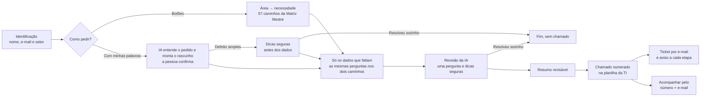
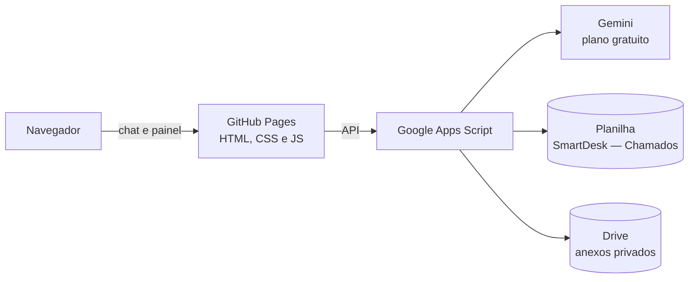

# SmartDesk — assistente de suporte de TI com IA

O SmartDesk é um chat em que os funcionários de uma escola pedem ajuda à equipe de TI. A pessoa escolhe o tipo de ajuda pelos botões ou conta o problema com as próprias palavras. A IA organiza o pedido, pergunta só o que falta, e a pessoa confere tudo antes de enviar. O chamado chega completo à equipe, numa planilha com número para acompanhar.

Projeto acadêmico da disciplina **Metodologias Ágeis e Validação de Produtos** (Graduação em IA e Automação Digital — UniFECAF). O objetivo não é entregar um produto pronto, e sim **descobrir, com usuários reais, se ele merece ser desenvolvido**.

| | |
|---|---|
| **Chat** | <https://andymarksss.github.io/Assistente-SmartDesk/> |
| **Painel de gestão (equipe de TI)** | <https://andymarksss.github.io/Assistente-SmartDesk/admin.html> |
| **Versão do protótipo** | [`03-prototipo/VERSAO.md`](03-prototipo/VERSAO.md) |
| **Situação** | Sessões com 5 usuários em 30/10/2026: problema confirmado, solução não; decisão: **pivotar** ([README do case](06-documentacao/case/README.md)) |

> Para testar, basta abrir o link do chat. Use dados fictícios: os chamados de teste chegam à planilha real da equipe de TI.

## Entrega da disciplina

| Entregável do enunciado | Onde está |
|---|---|
| **1. Parte teórica:** hipóteses e estratégia de validação | [`parte-teorica-hipoteses-e-validacao.md`](06-documentacao/parte-teorica-hipoteses-e-validacao.md) |
| **2. Parte prática:** README do case, com problema, hipóteses, experimento, evidências, resultados, aprendizados e decisão final | [`06-documentacao/case/README.md`](06-documentacao/case/README.md) |
| **3. Vídeo pitch** (3 min 58 s) | <https://drive.google.com/file/d/1hxUTYfH406xa7dd3I3ivs85zVpHdv-Vp/view> |
| PDF com as partes teórica e prática | [`smartdesk-entrega.pdf`](06-documentacao/case/smartdesk-entrega.pdf) |

Onde está cada item que o enunciado pede na parte prática:

| Item | Onde está |
|---|---|
| Canvas de Produto | [Lean Canvas antes e depois das sessões](06-documentacao/canvas/README.md) |
| Protótipo | O [chat](https://andymarksss.github.io/Assistente-SmartDesk/) publicado e o código em [`03-prototipo`](03-prototipo/README.md) |
| Validação com 5 usuários reais | [Experimento](06-documentacao/case/README.md#4-experimento), sessões de 30/10/2026 |
| Evidências e dados coletados | [Fichas das sessões transcritas (EVID-307)](05-evidencias/EVID-307_fichas-sessoes-p01-p05-transcricao.md) e [resultados com os números](04-validacao/resultados/resultados-sessoes-2026-10-30.md) |
| Síntese dos feedbacks e padrões | [Diário de validação](04-validacao/registros/diario-validacao.md) e a [seção 5 do case](06-documentacao/case/README.md#5-evidências-e-resultados) |
| Hipótese × resultados | [Seção 6 do case](06-documentacao/case/README.md#6-hipótese--resultado) |
| Decisão final justificada | [Seção 7 do case](06-documentacao/case/README.md#7-decisão-pivotar): **pivotar** |

## O problema

Na escola, os pedidos à TI chegam por quatro formulários separados (Audiovisual, Impressora, Google e TI) e também por WhatsApp, e-mail e pessoalmente. A pessoa precisa saber em qual pedir e quais dados informar, como data, horário e local de um evento, ou o modelo da impressora e a mensagem de erro. Quando escolhe o formulário errado ou esquece um dado, a TI precisa voltar a falar com ela antes de começar a atender.

## Como o SmartDesk funciona



- **Matriz Mestre:** 25 setores, 4 áreas, 57 caminhos de atendimento e 10 regras condicionais, montados a partir dos formulários reais. Por exemplo, só o Financeiro vê o QuickBooks.
- **IA (Gemini):** sugere o caminho a partir do relato livre, diz o que entendeu, preenche o rascunho e confere se o relato responde ao que o caminho pelos botões perguntaria (se não, o chat faz a mesma pergunta). Orienta quando o relato traz dois pedidos ou não é assunto da TI, faz no máximo uma pergunta sobre o que falta, sugere passos seguros em defeitos simples e escreve o assunto do chamado.
- **Limites da IA:** não conversa livremente, não muda a escolha da pessoa e não recebe nome, e-mail nem anexos. Toda sugestão passa por confirmação humana. Sem IA, o atendimento continua pelos botões.
- **Ticket por e-mail:** quem abre o chamado recebe o ticket no e-mail informado e um aviso a cada mudança de etapa. O e-mail leva só número, setor, pedido e etapa, nunca o texto do pedido.
- **Painel de gestão:** quadro por etapa (arrastar e soltar), indicadores e filtros por área e categoria, para a equipe de TI acompanhar os chamados.

Todos os caminhos possíveis, do início ao fim, estão na [árvore de decisões completa e no passo a passo do atendimento](06-documentacao/fluxo/README.md), com os pontos de IA destacados.

## Arquitetura



A interface é estática e roda no GitHub Pages. As chaves e o token ficam só nas propriedades do Apps Script, nunca no navegador nem no repositório. Para desenvolver, existe um servidor Node local com a mesma API (veja [`03-prototipo`](03-prototipo/README.md)).

## Validação

| | |
|---|---|
| **Hipótese de problema** | Os funcionários têm dificuldade para saber onde e como pedir ajuda à TI. Confirma-se se pelo menos 3 de 5 participantes relatarem dificuldade no jeito atual. |
| **Hipótese de solução** (escrita antes dos testes) | Funcionários da escola conseguem abrir um chamado completo pelo SmartDesk sozinhos, no caminho certo e em até 3 minutos. |
| **Experimento** | Planejado: teste de usabilidade moderado com pelo menos 5 funcionários, 3 situações reais cada uma e uma conversa curta no fim. Realizado em 30/10/2026 com 5 funcionários, em grupo e até o resumo, sem enviar ([limitações](06-documentacao/case/README.md#4-experimento)). |
| **Metas** | Sem ajuda ≥ 80% · caminho certo ≥ 80% · tempo médio ≤ 180 s · facilidade ≥ 4/5 · usariam de novo ≥ 80% |
| **Regra de decisão** | Perseverar, ajustar, pivotar ou abandonar, definida e aprovada antes das sessões ([parte teórica, seção 7](06-documentacao/parte-teorica-hipoteses-e-validacao.md#7-regra-de-decisão-definida-antes-das-sessões)). |
| **Resultado** | Problema confirmado (5 de 5). Só 1 das 5 metas atingida: caminho certo 87%; sem ajuda 67%; usariam no dia a dia 60%; tempo e facilidade não medidos. Decisão: **pivotar** ([README do case](06-documentacao/case/README.md#7-decisão-pivotar)). |

Lean Canvas: [`06-documentacao/canvas`](06-documentacao/canvas/README.md). Roteiro e instrumentos das sessões: [`04-validacao`](04-validacao/README.md).

## Estrutura do repositório

| Pasta | O que tem |
|---|---|
| [`01-planejamento`](01-planejamento/README.md) | Decisões de produto, fluxo do MVP e diário do projeto |
| [`02-matriz-e-regras`](02-matriz-e-regras/README.md) | Exportação da Matriz Mestre (caminhos, regras, setores e cenários de teste) |
| [`03-prototipo`](03-prototipo/README.md) | Código do chat, do painel, do servidor local e do Apps Script; CHANGELOG e relatórios de verificação |
| [`04-validacao`](04-validacao/README.md) | Roteiro das sessões, fichas, resultados e avaliação técnica da IA |
| [`05-evidencias`](05-evidencias/README.md) | Prints e registros numerados (EVID-###) de cada etapa |
| [`06-documentacao`](06-documentacao/README.md) | Parte teórica, Lean Canvas, árvore de decisões do atendimento, README de entrega do case e PDF da entrega |
| [`07-pitch`](07-pitch/README.md) | Link e roteiro do vídeo pitch |
| [`08-referencias`](08-referencias/README.md) | Fontes e referências usadas |

`AGENTS.md` traz as instruções de trabalho usadas pelos assistentes de IA que ajudaram a construir o protótipo.

## Rodar localmente

Requisitos: Node.js 22 ou superior.

```bash
cd 03-prototipo
npm ci
npm start
```

Abra <http://127.0.0.1:4173/>. Sem configuração, o chat funciona pelos botões e não envia chamados. Para ligar a IA e o envio, copie `.env.example` para `.env` e preencha a chave do Gemini e o endereço do Apps Script. O `.env` nunca vai para o Git. Os testes rodam com `npm test`, com Google e IA simulados.

## Privacidade

- Chaves, token e `.env` ficam fora do repositório.
- No painel publicado, nome e e-mail de outras pessoas aparecem abreviados, e os anexos ficam sem link.
- O ticket por e-mail não leva o texto do pedido, e e-mails de teste (exemplo.com, example.com…) não recebem nada.
- As métricas das sessões são anônimas: código do participante (P01…), sem nome, e-mail nem o texto do relato.
- Os testes usam só dados fictícios.

## Autor

**Anderson Barbosa Marques da Silva** — RA 16732 — Graduação em IA e Automação Digital, UniFECAF, 2026.

Este README apresenta o projeto. O **README de entrega do case** (problema, hipóteses, experimento, evidências, resultados, aprendizados e decisão final) está em [`06-documentacao/case`](06-documentacao/case/README.md).
